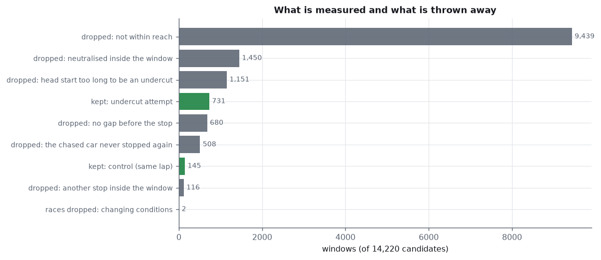
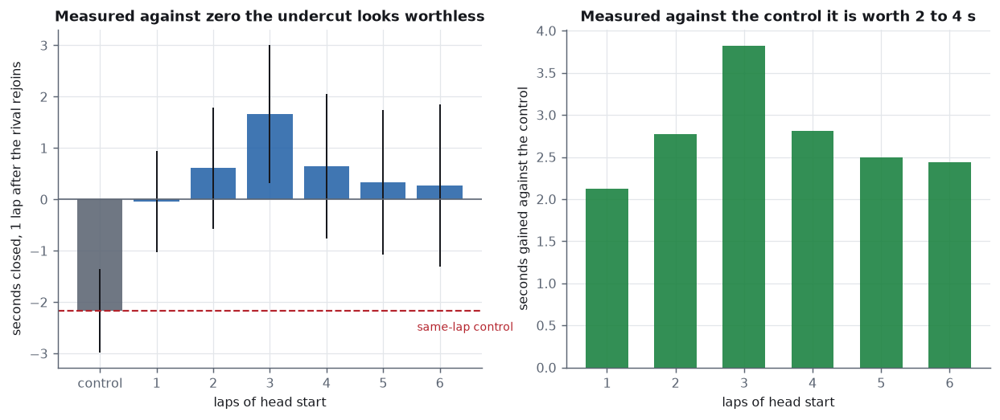
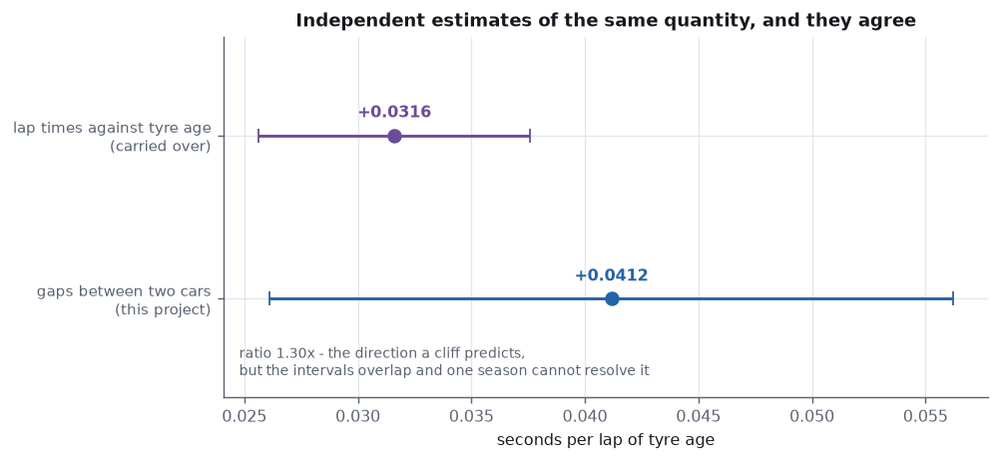
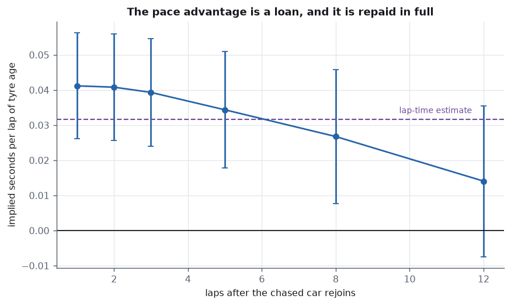
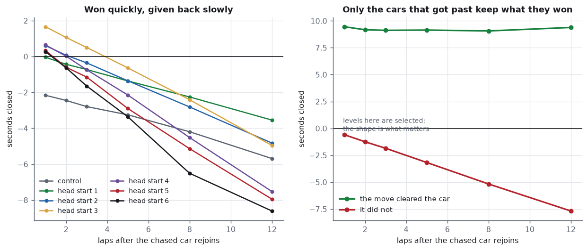
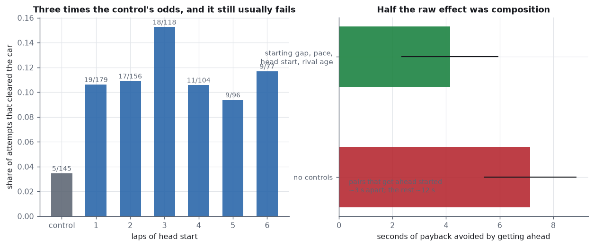

# Undercut effect

What pitting first is actually worth, measured from 24,386 Formula 1 lap
times and nothing else — no telemetry, no sector data, no gap feed.

This project exists because the one before it couldn't do this. The
[race-strategy-mc](https://github.com/Pratsss24/race-strategy-mc) model
proved that stint order cannot change race time, declared that as the
sharpest statement of its own scope, and said in its README: *there is no
undercut in here.* So here is the undercut, measured.

```
undercut attempts        731        same-lap controls        145
gain against control     +2.1 to +3.8 s, best at a 3-lap head start
implied degradation      +0.0412 s/lap  (lap-time method: +0.0316)
the pace gain            fully repaid by 12 laps - it is a loan
track position           +4.14 s of payback avoided by getting ahead
attempts that work       11.4%  (same-lap control: 3.4%)
```

---

## The gap is already in the lap times

A lap time feed looks like it holds no positional information. It does.
Summing a car's lap times gives its elapsed race time at the end of every
lap, and the difference between two cars' sums **is** the gap between them:

```
gap(A, B, n)  =  elapsed_B(n) - elapsed_A(n)
```

Same timing line, both cars, so this is exact — no interpolation and no
estimate. Everything here rests on that one observation.

A car a full lap down shows up as a gap of eighty-plus seconds rather than
as a lap, and the maximum-gap filter removes it. That filter is doing two
jobs, which is worth knowing.

---

## The problem, which is the same problem as last time

Teams don't attempt undercuts at random. They try one when they think it
will work. So the raw success rate of attempted undercuts is not the
effect of undercutting — it's the effect of undercutting *plus* the
judgement of the people who chose to try. Exactly the shape of the tyre
cliff problem in the strategy project, and it needs the same treatment:
something to compare against.

**The control is pairs of cars that pitted on the same lap.** They're
subject to everything else a race window contains — fuel burn, track
evolution, traffic, one car simply being quicker — and to no undercut at
all, because neither ever holds a tyre advantage over the other.



14,220 candidate windows reduce to 731 attempts and 145 controls. Every
exclusion is structural and declared in advance: neutralised windows
(1,450), pairs further apart than 25 s (9,439), a second stop inside the
window (116), head starts longer than six laps (1,151).

---

## Finding 1 — the control is not zero, and that's the whole point



| head start | pairs | seconds closed (95%) | against control | rival tyre age |
|---|---|---|---|---|
| **control (same lap)** | 145 | **−2.16 ± 0.80** | — | 17 |
| 1 | 179 | −0.04 ± 0.98 | **+2.12** | 16 |
| 2 | 156 | +0.61 ± 1.18 | **+2.77** | 16 |
| 3 | 118 | +1.66 ± 1.35 | **+3.82** | 16 |
| 4 | 104 | +0.64 ± 1.41 | **+2.81** | 14 |
| 5 | 96 | +0.33 ± 1.41 | **+2.49** | 15 |
| 6 | 77 | +0.27 ± 1.59 | **+2.44** | 14 |

A car that is behind is usually behind **because it is slower**, and in
these windows it loses about two seconds to the car ahead even when
neither gains any tyre advantage at all. Measured against zero, a one-lap
undercut looks worth nothing. Measured against the control, it's worth
2.1 seconds.

**A thing I had backwards.** I expected the undercutting car to be on
fresher tyres than the car it chases — pouncing on a struggling rival. The
data says the opposite: the chasing car averages **17.7 laps of tyre age
against the rival's 16.8**, widening to 18.2 against 16.0 at a six-lap
head start. You pit when *your* tyres are gone, not when your rival's are.
The move is more often forced than chosen, which makes it *less*
cherry-picked than the selection worry assumes.

### where the pit-lane time lands

A diagnostic that turned into a correction. At horizon zero — the lap the
chased car pits — the chasing car reads **−17.0 s**, for every head start
alike. That isn't an undercut failing; it's a pit loss not yet paid. In
this schema a stop recorded on lap `L` puts 2.85 s of excess on lap `L` and
**19.21 s on lap `L+1`**, so the pit-lane time is mostly in the out-lap.
Every horizon here is counted from one lap after the second stop, which is
the first point at which both cars have paid the same toll.

---

## Finding 2 — all of the gain runs through tyre age

The pure-pace model says the gain has exactly one channel. On each
advantage lap the chasing car is on a fresh set and the rival is on one of
age `T`, so it gains `d × T` per lap, for `k` laps. There is no term for
the head start on its own. Fitting both tests the claim:

| term | estimate | 95% interval | p |
|---|---|---|---|
| control | −0.7400 | −1.8916 to +0.4117 | 0.207 |
| per lap of head start | **+0.1237** | **−0.8201 to +1.0676** | 0.796 |
| per lap of head start × age | +0.0364 | −0.0018 to +0.0745 | 0.062 |
| prior pace | −0.3497 | −0.5855 to −0.1139 | 0.004 |

The free head-start term is indistinguishable from zero. The functional
form the physics implies survives a test it could have failed — so the
gain can be pushed entirely through the age channel, which turns that
coefficient into an estimate of the tyre-age penalty itself.

---

## Finding 3 — a second opinion on tyre degradation, and it agrees



| estimator | seconds per lap of age | 95% interval |
|---|---|---|
| **gaps between two cars** (this project) | **+0.0412** | +0.0261 to +0.0562 |
| lap times against tyre age (carried over) | +0.0316 | +0.0256 to +0.0376 |

Two estimators of the same physical quantity, built from completely
different features of the same season. One regresses a car's lap times on
its own tyre age over a long stint. The other reads the pace difference
between *two* cars, one fresh and one not, across a handful of laps.

The gap-based figure is **1.30×** the lap-time one — the direction a tyre
cliff predicts, since a linear fit through stints that ended before the
tyre went away understates the penalty. That was the strategy project's
central unresolved claim, and this is a genuinely independent way at it.

**But the intervals overlap, so this is agreement between two methods
rather than a contradiction.** One season cannot resolve the difference,
and the honest reading is that the lap-time estimate is corroborated, with
a hint — no more — in the direction predicted.

---

## Finding 4 — the pace advantage is a loan



| laps after the rival rejoins | implied penalty | 95% interval |
|---|---|---|
| 1 | +0.0412 | +0.0261 to +0.0562 |
| 2 | +0.0408 | +0.0257 to +0.0559 |
| 3 | +0.0393 | +0.0239 to +0.0547 |
| 5 | +0.0344 | +0.0178 to +0.0509 |
| 8 | +0.0267 | +0.0077 to +0.0458 |
| 12 | **+0.0141** | **−0.0074 to +0.0355** |

Read later and later, the implied penalty decays to nothing. That is
exactly what the pure-pace model predicts: once the rival has stopped, the
chasing car is the one on the older set, and it hands the gain back at the
same rate it won it. **On pace alone, an undercut buys nothing
permanent.**



---

## Finding 5 — but track position is not handed back



Split by whether the move actually cleared the car, the two groups behave
completely differently: cars that got past hold what they won, flat across
eleven laps, while cars that didn't give all of it back.

| term | estimate | 95% interval | p |
|---|---|---|---|
| payback when still behind | −3.035 | −4.923 to −1.148 | 0.002 |
| **ahead after the move** | **+4.142** | **+2.338 to +5.947** | 0.000 |
| gap before | −0.325 | −0.409 to −0.241 | 0.000 |
| prior pace | −0.931 | −2.131 to +0.270 | 0.128 |
| head start | −0.860 | −1.142 to −0.578 | 0.000 |
| rival age | +0.166 | +0.076 to +0.256 | 0.000 |

Getting ahead is worth **+4.14 s of payback avoided** over eleven laps.
A car that is now slower on pace simply doesn't lose the position, because
the quicker car is stuck behind it. That is the term the single-car
strategy model could not represent at all, measured.

The `head start` coefficient is a nice internal check: −0.86 s of extra
payback per lap of head start, which is the pure-pace model's prediction
that the debt grows with `k`.

> **Half the raw effect was composition, and I published the raw number
> first.** Uncontrolled, getting ahead looks worth **+7.14 s**. But pairs
> that end up ahead started about three seconds apart and pairs that don't
> started about twelve — and a pair that starts close is a pair of cars of
> similar pace, which drift apart slowly whatever happens. With the
> starting gap in the model it's +4.14 s. Real, highly significant, and
> about half what the first cut suggested.

Conditioning on the outcome at the early horizon would, if anything, bias
this *toward* finding mean reversion — a selected-high group drifting back
down — which is the opposite of the effect claimed. The direction of that
bias is conservative here.

---

## Finding 6 — and it usually doesn't work

| head start | attempts | cleared the car | share | still ahead 12 laps later |
|---|---|---|---|---|
| control (same lap) | 145 | 5 | 3.4% | 100% (of 5) |
| 1 | 179 | 19 | 10.6% | 79% |
| 2 | 156 | 17 | 10.9% | 76% |
| 3 | 118 | 18 | 15.3% | 83% |
| 4 | 104 | 11 | 10.6% | 82% |
| 5 | 96 | 9 | 9.4% | 78% |
| 6 | 77 | 9 | 11.7% | 56% |

Undercutting roughly **triples** the odds of getting past, from 3.4% to
11.4%. It still fails about 89% of the time. Both halves of that matter: a
move worth two to four seconds of pace is worth attempting, and it is
still a long shot, because two to four seconds is usually not enough to
clear a car.

---

## Two things I got wrong

**The track-position effect, by a factor of two.** The first version
compared cars that got ahead against cars that didn't and reported the
difference — +7.14 s. The groups weren't comparable: they differ in
starting gap by four to one. Controlling for it halves the estimate, and
`test_controlling_for_the_starting_gap_roughly_halves_that_effect` keeps
the correction from being quietly forgotten.

**Who undercuts whom.** I assumed the chasing car would be on fresher
rubber, pouncing. It is on *older* rubber, stopping because it has to.
The test that asserts this says in its own docstring what it was written
to expect.

---

## What this does not do

- **One season.** 2023 only. The degradation comparison in particular
  would benefit enormously from more, and its overlapping intervals are
  mostly a sample-size statement.
- **No compounds.** The Ergast schema never recorded them, so a stop onto
  a soft tyre and a stop onto a hard one are the same event here. Some of
  the spread in the measured gain is certainly that.
- **No causal identification of the attempt itself.** The same-lap control
  is a comparison group, not a randomisation. Teams choose both when to
  stop and whether to stop alongside a rival, and nothing here breaks that.
- **Pairs are not independent.** One stop puts the same car into a pair
  with every rival within reach. Errors are clustered on the car-race of
  the chasing car; clustering on the race instead leaves only twenty
  clusters, which is why it is not the headline.
- **The gap is a time gap, not a position.** "Cleared the car" means the
  gap went negative at the measured lap, which is what the stopwatch says
  and not necessarily what a steward would say about a lap-one scrap.

---

## Fachbegriffe

| English | Deutsch |
|---|---|
| undercut | der Undercut, das Vorziehen des Boxenstopps |
| overcut | der Overcut |
| track position | die Streckenposition |
| gap (between cars) | der Abstand, der Rückstand |
| elapsed race time | die Gesamtrennzeit |
| in-lap / out-lap | die Einfahrrunde / die Ausfahrrunde |
| pit loss | der Zeitverlust in der Boxengasse |
| stint | der Stint, der Reifenabschnitt |
| tyre age | das Reifenalter |
| tyre degradation | der Reifenabbau |
| tyre cliff | der Reifenabriss, die Abbaukante |
| safety car | das Safety Car |
| lapped car | der überrundete Wagen |
| control group | die Kontrollgruppe |
| selection bias | der Selektionsfehler |
| composition effect | der Zusammensetzungseffekt |
| confounder | die Störgröße |
| pre-trend | der Vortrend |
| mean reversion | die Regression zur Mitte |
| conditioning on the outcome | die Konditionierung auf das Ergebnis |
| cluster-robust standard error | clusterrobuster Standardfehler |
| least squares | die Methode der kleinsten Quadrate |
| confidence interval | das Konfidenzintervall |
| rank deficiency | der Rangabfall |
| functional form | die Funktionsform |
| horizon | der Zeithorizont |
| dose-response | die Dosis-Wirkungs-Beziehung |
| counterfactual | das kontrafaktische Szenario |

---

## Layout

```
run.py                  measure, test, report
src/data.py             the Jolpica/Ergast feed, cached per season
src/stints.py           which laps are usable, and why
src/model.py            the within estimator, for the comparison
src/pitloss.py          in-lap and out-lap excess, for the convention
src/gaps.py             elapsed times and the gap between two cars
src/pairs.py            undercut attempts and same-lap controls
src/effect.py           cluster-robust least squares and the models
src/charts.py           six figures
src/report.py           one self-contained HTML file
tests/test_undercut.py  32 tests
out/                    figures, report.html, _run.txt
```

```bash
pip install -r requirements.txt && python run.py && python -m pytest -q
```

`data.py`, `stints.py`, `model.py` and `pitloss.py` are carried over from
[stint-degradation](https://github.com/Pratsss24/stint-degradation) and
[race-strategy-mc](https://github.com/Pratsss24/race-strategy-mc).

## Sources

- Lap times, pit stops and results: the
  [Jolpica](https://api.jolpi.ca/ergast/f1/) mirror of the Ergast schema.
  Unauthenticated and rate limited.
- Kung-Yee Liang and Scott Zeger (1986) — cluster-robust standard errors.
- James Heckman (1979) — selection on the outcome, which both the control
  group and the payback model are built to work around.
